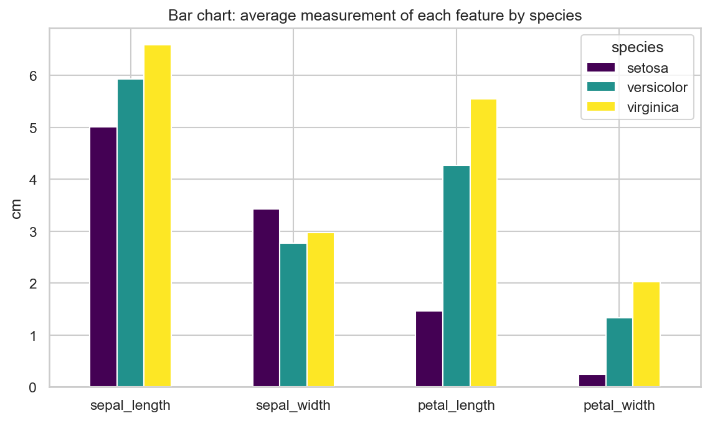
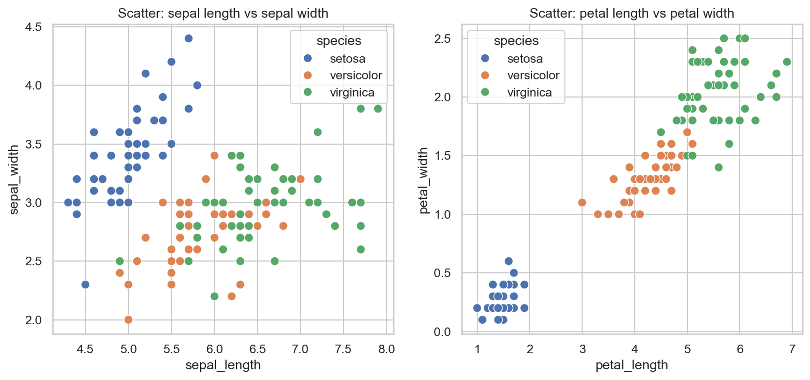
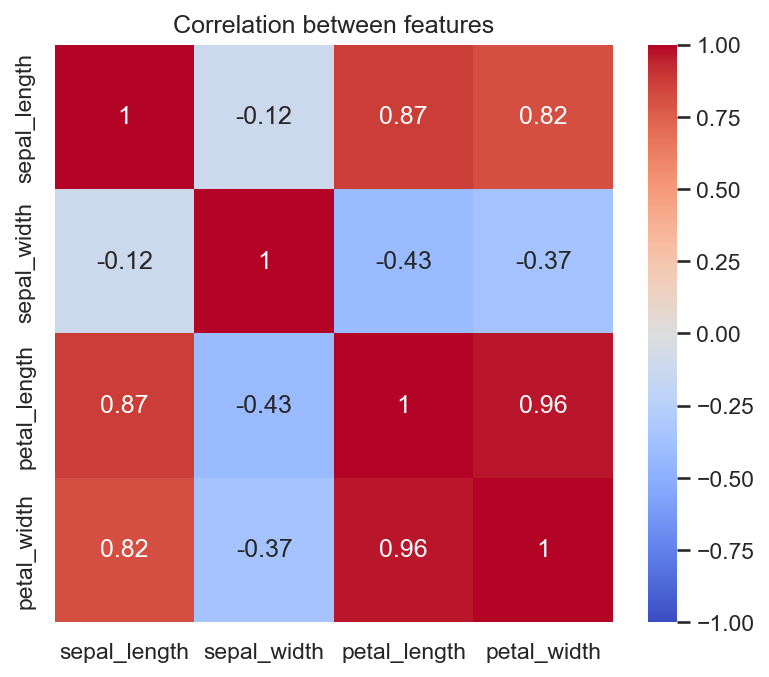
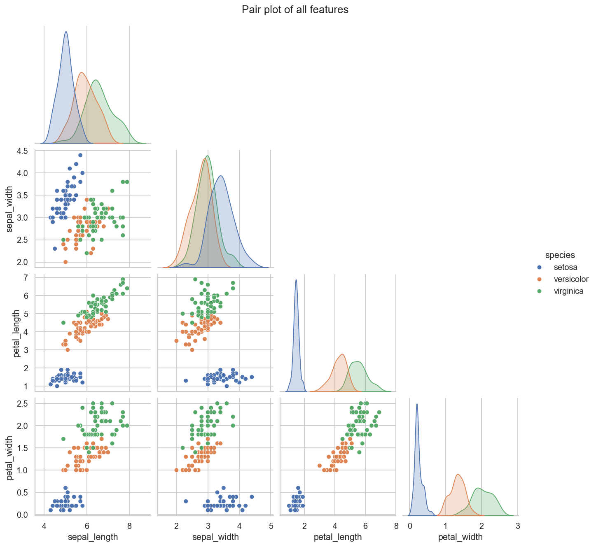

<p align="center"></p>
<p align="center"></p>
<p align="center"><a href="https://github.com/khnbutt118-dev">← Profile</a> · <a href="https://hassanbuttportfolio.vercel.app/">Portfolio</a> · <a href="https://www.linkedin.com/in/hassan-butt-ab0036334/">LinkedIn</a></p>

# 🌸 Iris · Exploratory Data Visualization
**Synent Technologies · Data Science Internship · Task 2**

<table><tr><td align="center"><h2>150</h2><sub>Samples</sub></td><td align="center"><h2>4</h2><sub>Features compared</sub></td><td align="center"><h2>0.96</h2><sub>Petal length-width correlation</sub></td></tr></table>

## 📊 Visual gallery

<p align="center"></p>
<p align="center"></p>
<p align="center"></p>
<p align="center"></p>

## 🔎 Key findings

| Finding | Result |
|:--|:--|
| Strongest separating feature | **Petal length** |
| Petal length vs width correlation | **0.96** |
| Mean petal length · Setosa | 1.5 cm |
| Mean petal length · Versicolor | 4.3 cm |
| Mean petal length · Virginica | 5.6 cm |

Petal length separated the three species most strongly in the ANOVA comparison (F = 1180); sepal width separated them least (F = 49). Setosa was completely separable from the other two species using petal length alone in this dataset.

## ▶️ Run

```bash
pip install -r requirements.txt
python main.py
```

<details><summary><b>Dataset & analysis</b></summary>

- Dataset: [Iris flower dataset](https://www.kaggle.com/datasets/uciml/iris)
- 150 rows × 5 columns
- Analysis includes species means, histograms, scatter plots, box plots, correlation heatmap, pair plot and ANOVA F-scores.
- Outputs: `outputs/`
</details>

---
<p align="center"><sub>Turning raw observations into clear visual insight.</sub></p>