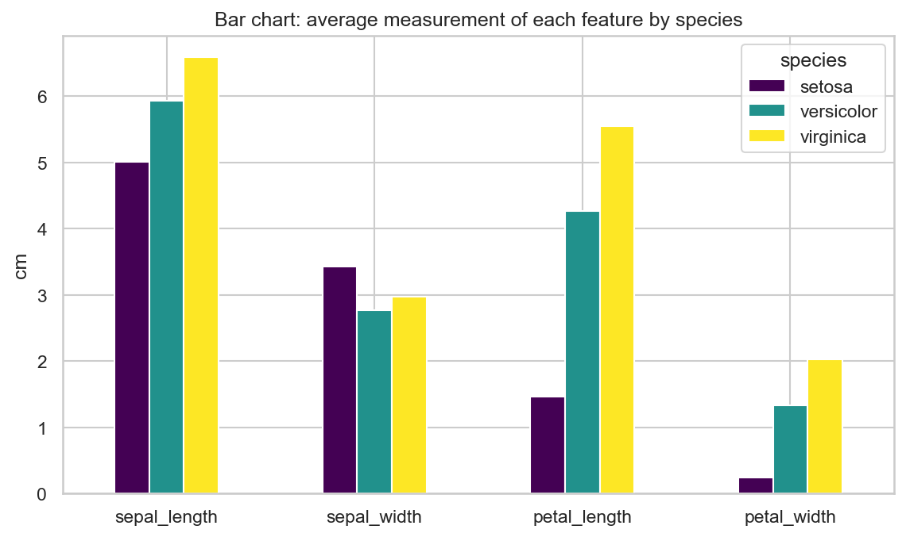
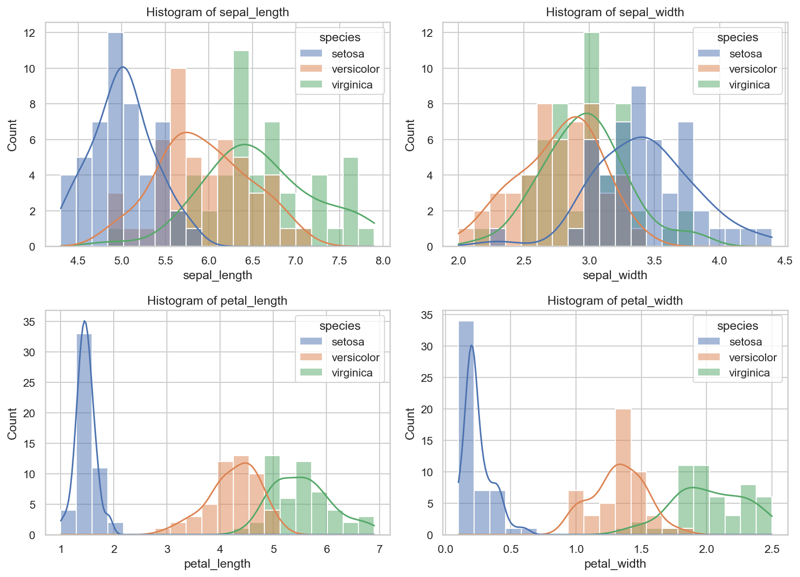
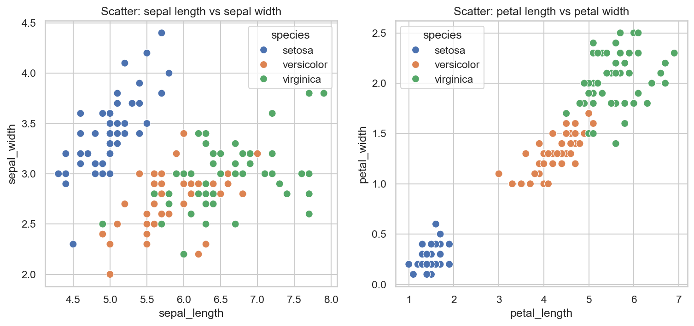
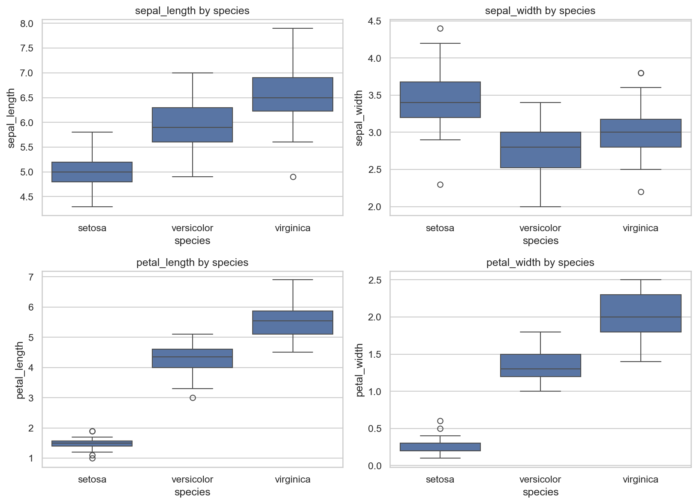
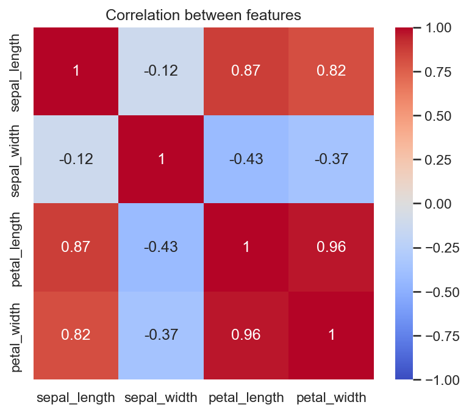
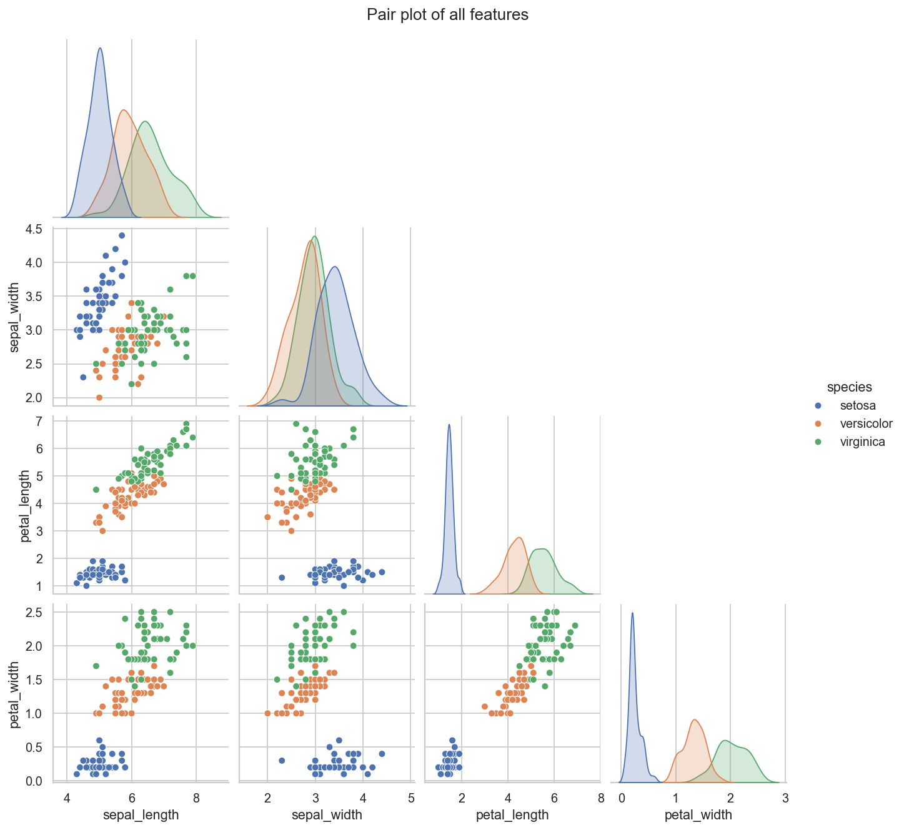

# Data Visualization (Iris)

> Synent Technologies Data Science Internship | Task 2 (Basic level) | Author: Hassan Butt

## Problem statement
Visualise patterns in the Iris dataset and compare features across the three species.

## Dataset details
- **Dataset:** Iris flower dataset
- **Source:** https://www.kaggle.com/datasets/uciml/iris
- **Size used:** 150 rows x 5 columns

## Approach
1. Bar chart of average feature values per species
2. Histograms with density curves per feature
3. Scatter plots of sepal and petal measurements
4. Box plots, correlation heatmap and pair plot to compare features
5. ANOVA F-scores to rank which feature separates the species best

## Results
| Metric | Value |
|---|---|
| Samples | 150 |
| Features compared | 4 |
| Best separating feature | petal_length |
| Petal length-width correlation | 0.96 |

**Key insights**

- petal_length separates the three species best (ANOVA F = 1180); sepal_width separates them least (F = 49).
- Petal length and petal width are strongly correlated (r = 0.96).
- Setosa is completely separable from the other two species using petal length alone.
- Average petal length: setosa 1.5 cm, versicolor 4.3 cm, virginica 5.6 cm.

**Figures**








## How to run
```bash
pip install -r requirements.txt
python main.py
```

## Project structure
```
main.py            # full analysis / pipeline
requirements.txt
data/              # dataset (see data/README.md)
outputs/           # figures, tables and reports
```

## Academic integrity
All analysis code and write-ups in this repository were written by the author. The dataset belongs to its original creators (see link above).
